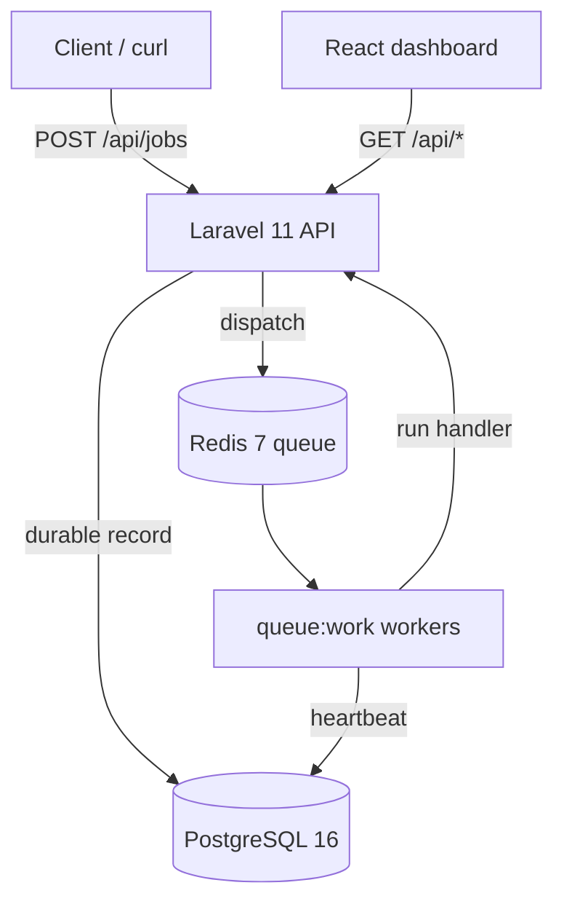
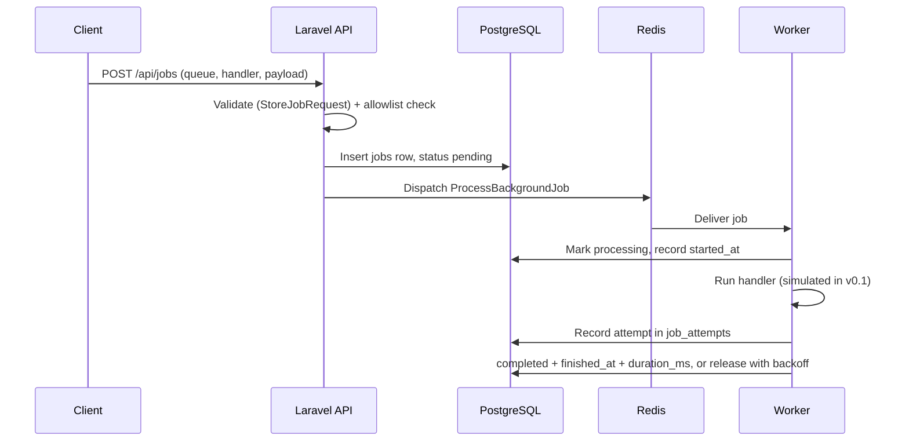

# Architecture

Background Job Manager is a simplified Laravel Horizon: a Laravel 11 API that records jobs in PostgreSQL and dispatches them through Redis, plus a React dashboard that reads the API. The full design notes live in `ARCHITECTURE.md` and `DECISIONS.md`; this page is the short, current version.

## System diagram

## Components

| Component | Technology | Role |
| --- | --- | --- |
| API | Laravel 11, PHP 8.2+ | Validates requests, stores jobs, dispatches to Redis, serves stats |
| Dashboard | React 18, Vite 6, TypeScript, Tailwind 4 | Polls the API every 5 seconds and shows jobs, queues, workers, stats |
| Queue backend | Redis 7 (Laravel queues, `predis/predis`) | Holds the transient work queue only |
| System of record | PostgreSQL 16 | Holds jobs, queues, attempts, workers, failed jobs |
| Worker | `php artisan queue:work` | Picks jobs off Redis, runs the handler, records the outcome |

Docker Compose runs five services: `postgres`, `redis`, `api`, `worker`, `frontend`. See `docker-compose.yml`.

## How a job flows

Steps in detail:

1. A client POSTs to `/api/jobs` with a queue name, a handler name, a payload, a priority, and a max attempt count.
2. `StoreJobRequest` validates the input. The handler must be in the allowlist in `JobDispatcher`; arbitrary class names from a request are never executed.
3. A `jobs` row is created with status `pending`, and the job is pushed onto the named Redis queue as a `ProcessBackgroundJob` instance.
4. A worker picks the job up, marks it `processing`, records `started_at`, runs the handler, and records an attempt in `job_attempts`.
5. On success the job becomes `completed` with `finished_at` and `duration_ms`. On failure the worker releases the job with exponential backoff (`2^attempt * base seconds`) until `max_attempts` is reached, then marks it `failed` and writes a row to `failed_jobs` (the Laravel convention).
6. Retrying a failed job from the dashboard re-queues it with status `retrying`, an incremented attempt count, and a fresh backoff delay.

## Data model

Tables (see `backend/database/migrations/`):

- `queues` - name, priority, concurrency, `is_paused`. Seeded: `default`, `emails`, `reports`, `images`, `sync`.
- `jobs` - queue reference, handler name, payload (JSON), status, priority, attempts, `max_attempts`, `started_at`, `finished_at`, `duration_ms`.
- `job_attempts` - one row per execution attempt, with the outcome and error message.
- `workers` - name, hostname, status, current job, heartbeat timestamp, processed and failed counters.
- `failed_jobs` - the Laravel convention table for jobs that exhausted their attempts.

## Why PostgreSQL for job records, not Redis only

Redis is fast and is the right place for the queue itself, but it is a poor system of record: data can be evicted, it has no relational queries, and rebuilding history after a restart is painful. PostgreSQL stores the durable record so the dashboard can filter, search, aggregate statistics, and keep an audit trail. Redis holds only the transient work queue.

## Delivery semantics: at-least-once

Jobs are delivered at-least-once, not exactly-once. A worker can crash after doing the work but before marking the job complete, and the job will then run again. Handlers must therefore be idempotent where it matters (for example, check whether the email was already sent before sending it again). This project never claims exactly-once delivery.

## Workers and heartbeats

Each worker process registers itself in the `workers` table and updates `last_heartbeat_at` while it runs. A worker is `idle` when it has no current job, `busy` while processing one, `stale` when its heartbeat is older than the configured threshold (default 60 seconds, `WORKER_STALE_AFTER_SECONDS`), and `offline` after `workers:prune-stale` marks stale workers offline. The dashboard shows processed and failed counts per worker.

## What is simulated in v0.1

The four handlers (`SendEmail`, `GenerateReport`, `ResizeImage`, `SyncExternalData`) are simulated: they sleep for `simulate.duration_ms` and optionally throw the configured `simulate.fail_message`. They do not send real emails, generate real files, resize real images, or call real external APIs. The simulation is deterministic and exists so the dashboard, retries, backoff, and statistics can be demoed without external services. Real handler implementations belong behind the same registry interface in `backend/app/Services/JobDispatcher.php`.

## Key code paths

- `backend/routes/api.php` - all API routes.
- `backend/app/Http/Controllers/Api/` - `JobController`, `QueueController`, `WorkerController`, `StatsController`.
- `backend/app/Services/JobDispatcher.php` - handler allowlist and simulated execution.
- `backend/app/Services/QueueStatsService.php` - pure-PHP stats (arrays in, arrays out, no framework dependency), so it is unit-testable and smoke-testable without booting Laravel.
- `backend/app/Services/WorkerRegistry.php` - worker registration, heartbeat, stale pruning.
- `backend/app/Jobs/ProcessBackgroundJob.php` - the queued job the worker executes.
- `frontend/src/api.ts` - API client used by the dashboard pages.
- `frontend/src/pages/` - Dashboard, Jobs, JobDetail, Queues, Workers.

## What was deliberately left out of v0.1

- Real handler side effects (email, files, image processing, external APIs).
- User accounts and per-user tokens (the API uses a single shared key when `JOB_MANAGER_API_KEY` is set).
- Scheduled and recurring jobs.
- Horizontal worker autoscaling.
- Metrics export (Prometheus) and alerting.
